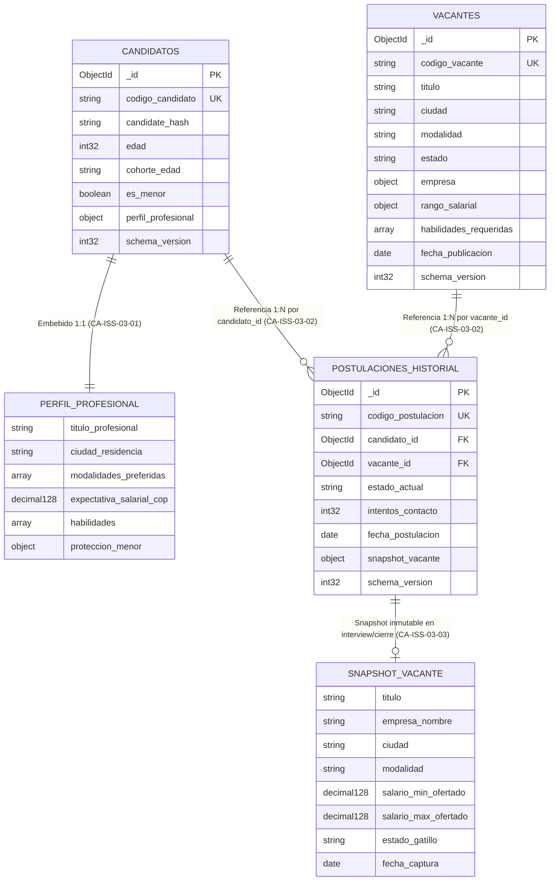

# Modelo Documental v1 y Patrón Snapshot — Youth Employment Bridge (YEB)

**Módulo:** `analytics/` (Persistencia NoSQL) | **Issue:** `#03 [NoSQL/Model]` | **Criterios cubiertos:** `CA-ISS-03-01` a `CA-ISS-03-04`  
**Base de datos:** `yeb_analytics_lab` | **Riesgos mitigados:** `TEC-009`, `NEG-006` | **Casos de prueba:** `CP-043`, `CP-043B`, `CP-043C`

---

## 1. Arquitectura de Colecciones Documentales (`candidatos`, `vacantes`, `postulaciones_historial`)



---

## 2. Decisiones de Modelado: Embebido vs. Referenciado (`CA-ISS-03-01`, `CA-ISS-03-02`)

| Relación | Estrategia Adoptada | Justificación Técnica y de Negocio |
| :-- | :-- | :-- |
| **Candidato ↔ Perfil Profesional** (`habilidades`, `expectativa_salarial_cop`, `proteccion_menor`) | **Subdocumento 1:1 Embebido** dentro de `candidatos` (`CA-ISS-03-01`) | El perfil profesional se consulta siempre junto al candidato (localidad de datos). El arreglo `habilidades` está acotado naturalmente (entre 1 y 30 habilidades por joven), por lo que el documento completo de un candidato pesa `~0.9 KB`, sin riesgo de crecimiento ilimitado. |
| **Vacante ↔ Empresa y Rango Salarial** | **Subdocumentos 1:1 Embebidos** dentro de `vacantes` | Al listar o filtrar vacantes (Consulta Esencial `CE-01`), se requiere mostrar simultáneamente razón social, sector y banda salarial (`minimo`/`maximo` en `Decimal128`) en una sola lectura atómica sin `$lookup`. |
| **Candidato / Vacante ↔ Historial de Postulaciones** | **Colección Independiente Referenciada (`postulaciones_historial`)** mediante `ObjectId` (`CA-ISS-03-02`) | Un joven activo puede postularse a cientos de vacantes a lo largo del tiempo, y una vacante masiva de nivel inicial puede recibir miles de postulaciones. Incrustar las postulaciones como un arreglo dentro de `candidatos` o `vacantes` constituye el antipatrón de *Unbounded Array* y arriesga superar el límite BSON de **16 MiB** (`TEC-009`). |

---

## 3. Especificación del Patrón Snapshot (`CA-ISS-03-03` / Mitigación `NEG-006`)

### 3.1 Problema de Negocio (`NEG-006`)
Durante el ciclo de vida de una oferta laboral en `vacantes`, la empresa puede modificar el título del cargo, la modalidad (`Remoto` → `Presencial`) o el rango salarial (`rango_salarial.minimo` y `maximo`). Si la postulación solo guarda `vacante_id`, cualquier auditoría o reclamo posterior de un candidato entrevistado o contratado leería los valores modificados y no las condiciones reales vigentes cuando avanzó en el proceso.

### 3.2 Regla de Disparo e Inmutabilidad del Snapshot
1. **Estados Iniciales (`pending`, `review`)**:
   - El campo `snapshot_vacante` se inicializa en `null`.
2. **Transición a Estado Relevante (`interview`) o Definitivo (`accepted`, `rejected`)**:
   - En el instante en que la postulación transiciona a `interview`, `accepted` o `rejected` (y si `snapshot_vacante` aún es `null`), el sistema lee el estado actual de la vacante en `vacantes` e incrusta de forma atómica el subdocumento `snapshot_vacante`:
     ```json
     "snapshot_vacante": {
       "titulo": "Gestor Junior de Atención Digital y Comunidad",
       "empresa_nombre": "ConectaJoven Digital",
       "ciudad": "Bogotá",
       "modalidad": "Remoto",
       "salario_min_ofertado": { "$numberDecimal": "1300000.00" },
       "salario_max_ofertado": { "$numberDecimal": "1500000.00" },
       "estado_gatillo": "interview",
       "fecha_captura": { "$date": "2026-11-04T12:30:00.000Z" }
     }
     ```
3. **Garantía de Inmutabilidad**:
   - Una vez capturado el `snapshot_vacante`, ninguna edición ulterior sobre la colección `vacantes` ni transiciones posteriores (`interview` → `accepted`) sobrescriben los valores históricos pactados en `snapshot_vacante`.

---

## 4. Semillas Reproducibles en Extended JSON (`CA-ISS-03-04`)

Los archivos semilla se encuentran en `analytics/data/seeds/` en formato Extended JSON canónico (`.ejson`), preservando tipos estrictos (`$oid`, `$date`, `$numberInt`, `$numberDecimal`):

| Archivo Semilla | Colección Destino | Registros | Integridad Referencial |
| :-- | :-- | :-: | :-- |
| [`analytics/data/seeds/candidatos.ejson`](../data/seeds/candidatos.ejson) | `candidatos` | 6 | Claves primarias `_id` (`6728c0ffee00000000000101` a `...106`) |
| [`analytics/data/seeds/vacantes.ejson`](../data/seeds/vacantes.ejson) | `vacantes` | 5 | Claves primarias `_id` (`6728c0ffee00000000000201` a `...205`) |
| [`analytics/data/seeds/postulaciones.ejson`](../data/seeds/postulaciones.ejson) | `postulaciones_historial` | 8 | **0 referencias rotas**: el 100 % de `candidato_id` y `vacante_id` existen en sus colecciones padre. |
